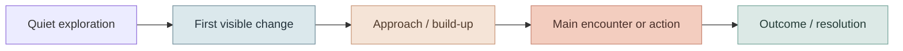
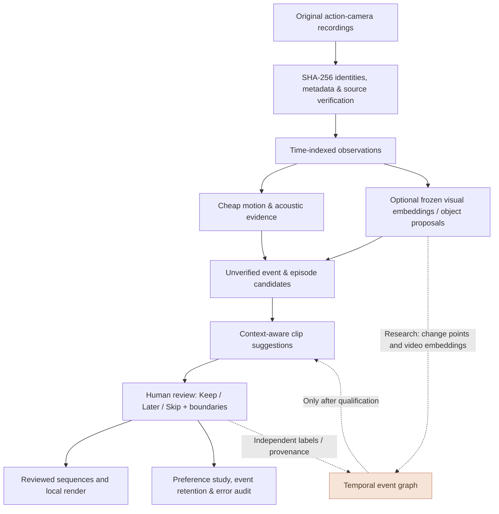

<div align="center">
  <h1>Adventure-Klip</h1>
  <h3>Understand the action. Preserve the experience.</h3>
  <p><strong>Local-first, evidence-grounded temporal video intelligence for skiing, mountain biking, snorkeling, and exploratory footage.</strong></p>
  <p>
    <a href="https://github.com/sidhulyalkar/adventure-klip/actions/workflows/ci.yml"></a>
    
    
    
  </p>
  <p>
    <a href="#the-problem">The problem</a> ·
    <a href="#the-mathematics">The mathematics</a> ·
    <a href="#system-design">System design</a> ·
    <a href="#run-it-locally">Run locally</a> ·
    <a href="#research-roadmap">Research roadmap</a> ·
    <a href="#contribute">Contribute</a>
  </p>
</div>

---

> **The central idea:** A remarkable moment is rarely a single remarkable frame. It is a sequence: the approach, the change, the action, and the resolution. Adventure-Klip aims to discover those sequences without confusing visual motion with real-world events, or machine-generated scores with human experience.
>
> **Current status:** The baseline local video index, visual and motion evidence, review workflows, and reel tools are available on `main`. More advanced adaptive sampling, multi-scale temporal investigations, preference studies, and archive pipelines live in **unmerged experimental PRs**. Read the [implementation-status guide](docs/README.md) before following commands from an experimental branch.

## The problem

Suppose a first-person snorkeling camera records 20 minutes of ocean footage. A ray might enter the image after a long quiet swim, approach, pass the camera, and disappear. A high-scoring still frame may show the animal beautifully while leaving out everything that made the encounter meaningful.

| A frame-based system notices | A temporal system should investigate | An editor must decide |
|:--|:--|:--|
| An animal-like shape | **Discovery → approach → pass → departure** | Which portion preserves the encounter? |
| A sharp ski-camera movement | **Preparation → motion → possible airborne phase → landing** | Was a complete maneuver actually visible? |
| A dramatic turn on singletrack | **Obstacle approach → trajectory change → recovery** | Did the proposed cut preserve cause and consequence? |
| A loud transient or a splash | **Audio and visual changes with uncertain origin** | Is it relevant, misleading, or unobservable? |

**The objective is not to maximize motion, novelty, or model certainty.** It is to build a **verifiable account of an unfolding event**, then ask whether people prefer the resulting clips.

The four distinct questions are:

1. **What was observed?** Frames, audio, camera movement, objects, timestamps, and missing evidence.
2. **What might have happened?** Event and temporal-phase hypotheses, with uncertainty and alternatives.
3. **What makes a complete clip?** Context, event-core retention, continuity, and pacing.
4. **Was the outcome useful?** Blind human preference, discovery recall, editing time, and failure analysis.

**A classifier's confidence is not editorial value.** A frame similarity is not an animal identification. A camera jerk is not proof of a jump, fall, or injury.

## A scene has a timeline, not just a thumbnail



This is an **illustrative narrative template**, not a current verified action classifier. Some clips contain multiple events, non-linear structure, interruptions, or no identifiable payoff. A correct system must allow all of those.

| Temporal level | Initial working range | Question |
|---|---|---|
| **Micro** | ~0.25–2 s | Did the image, sound, camera, or object motion change? |
| **Meso** | ~2–30 s | Was there a complete approach, maneuver, interaction, or transition? |
| **Macro** | ~10–120+ s | How does a sequence of events form an interpretable experience? |

These time scales are **research design ranges**, not universal constants or validated physiological/sport thresholds.

## The mathematics

### 1. Evidence is time-indexed and source-grounded

A recording is an observation stream, not an already labeled set of actions:

$$
\mathcal{X}=\{(t_i,\mathbf{v}_i,\mathbf{a}_i,\mathbf{m}_i,\mathbf{p}_i)\}_{i=1}^{N}
$$

Here, \(\mathbf{v}\) denotes visual representations, \(\mathbf{a}\) audio cues, \(\mathbf{m}\) motion measurements, and \(\mathbf{p}\) provenance and timing metadata. Any modality can be missing. Source-video-relative timestamps, decoded presentation timestamps, and rendered timestamps must not be assumed identical.

### 2. Visual change is a clue, not an event

For compatible frozen frame embeddings, a useful inexpensive proposal signal is:

$$
\Delta_i=1-\frac{\mathbf{v}_i^\top\mathbf{v}_{i-1}}
{\lVert\mathbf{v}_i\rVert_2\lVert\mathbf{v}_{i-1}\rVert_2}
$$

A high \(\Delta_i\) can reflect a meaningful event **or** a pan, bubbles, occlusion, lighting change, scene cut, or equipment shake. Sampling gaps are recorded as **unknown** instead of quietly interpolated into evidence. This is the idea behind the optional [Temporal Lite prototype, PR #82](https://github.com/sidhulyalkar/adventure-klip/pull/82), **not a feature released on `main`**.

### 3. The research objective is complete, useful clips

Let \(E\) be candidate events and \(C\) an edit composed of source-relative intervals. One conceptual objective is:

$$
\max_{C}\;
\underbrace{\alpha\,R_{\mathrm{event}}(C,E)}_{\text{preserve critical action}}
+\underbrace{\beta\,U_{\mathrm{human}}(C)}_{\text{human preference}}
+\underbrace{\gamma\,D(C)}_{\text{diversity}}
-\underbrace{\delta\,J(C)}_{\text{jarring or incomplete cuts}}
$$

subject to a duration budget \(\sum_{c\in C}|c|\le B\), source bounds, human exclusion intervals, and explicit approval for publishing. These are **proposed research terms**, not a trained or calibrated production objective. Event-core retention is measurable against independent human annotations. Human utility must be evaluated with **blind preferences**, not assumed from a model's explanation.

The [full problem formulation](docs/PROBLEM_FORMULATION.md) defines hypotheses, temporal uncertainty, evaluation metrics, failure cases, and experimental baselines.

## System design



**Solid arrows:** the existing architecture on the repository's baseline, with optional components explicitly enabled. **Dashed arrows:** research and future integration. Models should create *inspectable proposals* and retain their source evidence. Human review, exclusions, and export approval remain independent gates.

### What is implemented, experimental, and still missing?

| Capability | Implementation state | Where to look |
|---|---|---|
| Local catalog, hash identities and managed ingest | **Core on `main`; known indexed-to-managed import fix still open in [#2](https://github.com/sidhulyalkar/adventure-klip/pull/2)** | [Processing](docs/PROCESSING.md) |
| Basic activity/motion evidence and video-local timelines | **Core on `main`** | [Architecture](docs/ARCHITECTURE.md) |
| Optional image embeddings and open-vocabulary object proposals | **On `main`, opt-in** | [Review-driven scene atlas](docs/REVIEW_DRIVEN_SCENE_ATLAS.md) |
| Event proposals, human reviews, context-aware trim suggestions | **On `main`, provisional** | [Trim policy](docs/CLIP_TRIM_POLICY.md) |
| Local Studio, review history, candidate reels and rendering | **On `main`** | [Focused review](docs/FOCUS_REVIEW_LIBRARY.md) |
| Adaptive frame budgets, richer segmentation and temporal investigation | **Unmerged PR stack** | [Integration map](docs/PR_INTEGRATION_PLAN.md) |
| Cache-only visual transition graph | **Unmerged draft PR #82** | [Temporal Action Intelligence](https://github.com/sidhulyalkar/adventure-klip/blob/feat/temporal-lite-action-graph-v1/docs/TEMPORAL_ACTION_INTELLIGENCE.md) |
| Editable goal × sub-sport scene relevance profiles (35 normalized dimensions, 18 sub-sports, 5 goals) | **On `main` after V1 merge: offline scoring only, weights not learned** | [Sub-sport profile guide](docs/KLIP_SUBSPORT_PROFILES_V1.md) |
| Validated action-phase recognition, learned temporal utility, calibrated event ranking | **Research goals, not validated** | [Problem formulation](docs/PROBLEM_FORMULATION.md) |

## Run it locally

**Requirements:** Python 3.11+, FFmpeg / FFprobe, and a local workspace. The Python distribution is `adventure-klip`; its import module remains `adventure_intelligence`.

```bash
# macOS example
brew install ffmpeg
python3 -m venv .venv
source .venv/bin/activate
python -m pip install -e '.[vision,images,dev]'

# A separate workspace preserves the original media directory.
export WS="$HOME/AdventureAI"
klip --workspace "$WS" init
```

### One small, reproducible first pass

Use a **small stable test folder**, not your complete removable SSD archive:

```bash
# Index without copying or moving existing footage.
klip --workspace "$WS" index "$HOME/Movies/DJI Pilot" --activity ski --dry-run
klip --workspace "$WS" index "$HOME/Movies/DJI Pilot" --activity ski

# Start with inexpensive observable evidence.
klip --workspace "$WS" analyze
klip --workspace "$WS" timeline --source pixel-change
klip --workspace "$WS" scenes --backend histogram --every 4

# Inspect and edit. Nothing is published automatically.
klip --workspace "$WS" studio
```

To generate a draft review plan and a separate MP4:

```bash
klip --workspace "$WS" plan --recipe ski-highlights \
  --seconds 75 --output "$WS/exports/plan.json"

klip --workspace "$WS" render "$WS/exports/plan.json" \
  --output "$WS/reels/ski-review.mp4" --transition cut
```

For stable permanent folders, `klip --workspace "$WS" process PATH --activity ski` can index and analyze incrementally. An asset indexed externally is **not proof that a managed import copy exists**; see [the pending import-safety fix in PR #2](https://github.com/sidhulyalkar/adventure-klip/pull/2) and verify managed copies before removing original media. For removable DJI cards, prefer `klip ingest CARD/DCIM` to make checksum-verified managed copies. Never assume a disconnected SSD is safely replaceable, and do not switch checkouts, reinstall dependencies, or initiate a full video pass while an existing processing job is running. See [Processing](docs/PROCESSING.md).

### Optional semantic evidence

```bash
python -m pip install -e '.[semantic]'
klip --workspace "$WS" scenes --backend siglip2 --every 4 --limit 1
klip --workspace "$WS" scenes --backend owlv2 --every 4 --limit 1
```

The optional providers download model weights when deliberately invoked. SigLIP2 produces appearance embeddings, **not verified motion or animal identity**; OWLv2 object boxes are unverified detections. A sparse sample can miss short events. Use `klip --help` and the linked branch-specific documentation for other commands.

## Research roadmap


**Research question:** Can hierarchical temporal event representations improve **human-preferred clip completeness and action retrieval** compared with frame novelty and fixed-context rules, at a justified compute and annotation cost?

A first controlled study will compare the existing baseline, deterministic context padding, a cache-only temporal representation, and a frozen contiguous-video encoder. It will include random-source negatives, different trips in held-out evaluation, multi-rater onset/peak/resolution annotations, and blind same-event A/B edits.

We will report **event-core retention, preference with uncertainty, time to usable edit, missed events in random-source footage, computational cost, and abstention/coverage**. We will not claim improvement before that experiment exists.

Track research [milestones in issue #83](https://github.com/sidhulyalkar/adventure-klip/issues/83) and [the unmerged PR integration plan](docs/PR_INTEGRATION_PLAN.md).

## Scientific and data-safety commitments

- **Source immutable by default:** source content identities are verified and generated artifacts belong in a separate workspace. No automatic deletion, public export, or third-party video upload.
- **Observation ≠ ground truth:** optical flow is not athlete speed; camera jolts do not establish crashes; an audio transient does not prove breathing; object-text similarity does not verify species.
- **Absent evidence ≠ negative evidence:** missing frames, inaccessible files, sparse sample gaps and failed model calls remain distinguishable.
- **Source-relative time is explicit:** timestamps are not fabricated from frame numbers or silently conflated with decoded PTS.
- **People decide what matters:** model proposals are not training labels or publication approvals. Later training requires provenance, review separation, privacy controls, and appropriate rights.
- **Failure preservation:** report difficult negatives, disagreement, false positives, misses, and model abstentions alongside any apparent success.

## Repository guide

| Directory | Purpose |
|---|---|
| `src/adventure_intelligence/` | Core indexing, evidence, curation, timelines, local Studio and rendering |
| `tests/` | Synthetic and integration regressions; not evidence of real-video recognition accuracy |
| `docs/` | Architecture, experimental contracts, tutorials and evaluation protocols |
| `examples/` | Synthetic/example inputs; not private DJI recordings |
| `macos/` | Optional local mount-agent experiments |
| `.github/` | CI and collaboration workflows |

Use the [documentation index](docs/README.md) to find the correct guide and avoid confusing merged `main` capabilities with unfinished branch experiments.

## Contribute

Adventure-Klip is Apache-2.0 licensed. Contributions are welcome for improved temporal representations, human-centered evaluation, source-safe decoding, motion compensation, ecology observations, annotation methods and reproducibility.

Before opening a PR, start with [CONTRIBUTING.md](CONTRIBUTING.md), add synthetic false-positive controls, name your model and data provenance, specify how a hypothesis could fail, and keep private videos, location histories, identifiable bystanders, licenses and pretrained weights **out of Git**.

```bash
python -m pytest -q
python -m build
```

**The goal:** move from *"this frame looks interesting"* to *"this complete event is worth watching, and here is the evidence and human evaluation behind that decision."*
